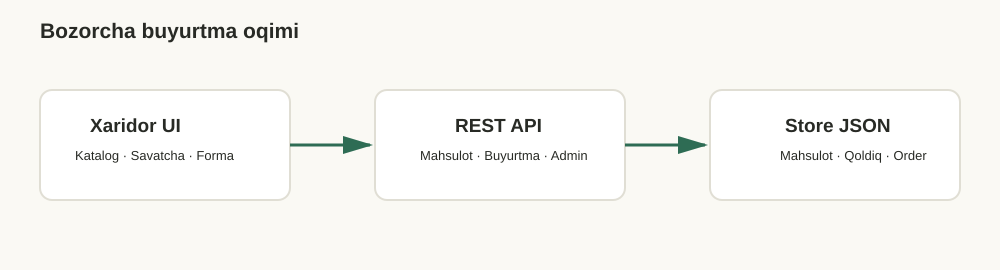

# Bozorcha

**Mahalliydan. Mehr bilan.** Bozorcha — mahalliy ishlab chiqaruvchilar va xaridorlarni bog‘laydigan mini-webstore. Katalogdan mahsulot tanlanadi, savatchaga qo‘shiladi va xaridor ism, telefon hamda manzilini kiritib buyurtma beradi.



## Muammo va yechim

Kichik ishlab chiqaruvchilar ko‘pincha mahsulotlarini ijtimoiy tarmoq postlari va chatlar orqali sotadi. Xaridor uchun narx, mavjud qoldiq va buyurtma holatini kuzatish qiyin. Bozorcha katalog, qidiruv, kategoriya filteri, savatcha va server tomonida hisoblanadigan buyurtma oqimini bitta oddiy joyga yig‘adi.

## Asosiy imkoniyatlar

- mahsulot nomi, tavsifi, narxi, ishlab chiqaruvchisi va qoldig‘ini ko‘rsatish;
- mahsulotlarni qidirish va kategoriya bo‘yicha filterlash;
- savatchaga qo‘shish, miqdorni oshirish/kamaytirish va olib tashlash;
- xaridor ma’lumotlari bilan buyurtma yuborish;
- backend buyurtma summasini qayta hisoblaydi va qoldiqni kamaytiradi;
- admin kaliti bilan buyurtmalarni ko‘rish va statusini yangilash API’i;
- yangi, tasdiqlangan, yetkazilmoqda, bajarildi va bekor qilindi statuslari;
- responsive desktop va mobil katalog;
- API xatolari, bo‘sh savatcha va qoldiq tugagan holatlar.

## Texnologiyalar

| Qism | Texnologiya |
|---|---|
| Frontend | Semantic HTML, CSS, Vanilla JavaScript |
| Backend | Node.js built-in HTTP server |
| API | REST + JSON |
| Saqlash | JSON fayl (`data/store.json`) |
| Tekshiruv | `node --check` va smoke testlar |

Loyiha tashqi AI API yoki pullik servisga bog‘liq emas. Server tomonida buyurtma summasi doim katalogdagi haqiqiy narxlar asosida qayta hisoblanadi; frontend yuborgan summaga ishonilmaydi.

## Ishga tushirish

```bash
git clone https://github.com/RaximjonRaximov/bozorcha.git
cd bozorcha
cp .env.example .env
npm start
```

Brauzerda `http://localhost:3020` manzilini oching. Node.js 18 yoki undan yangi versiya kerak. Development rejimida `npm run dev` dan foydalanish mumkin.

## API

| Method | Endpoint | Vazifasi |
|---|---|---|
| GET | `/api/health` | Server holatini tekshirish |
| GET | `/api/products` | Mahsulotlar ro‘yxati |
| GET | `/api/products?q=asal&category=Oziq-ovqat` | Qidiruv va filter |
| GET | `/api/categories` | Kategoriya ro‘yxati |
| POST | `/api/orders` | Yangi buyurtma yaratish |
| GET | `/api/orders` | Admin buyurtmalarini olish |
| PATCH | `/api/orders/:id` | Admin order statusini yangilash |

Buyurtma yuborish namunasi:

```json
{
  "customer": {
    "name": "Dilshod Karimov",
    "phone": "+998 90 123 45 67",
    "address": "Toshkent sh., Yunusobod tumani"
  },
  "items": [
    {"productId": "p1", "quantity": 2}
  ]
}
```

Admin endpointlari `x-admin-key` headerini talab qiladi. Lokal default qiymat `.env.example` dagi `demo-admin-key`:

```bash
curl http://localhost:3020/api/orders \\
  -H 'x-admin-key: demo-admin-key'
```

Buyurtma statusini o‘zgartirish:

```bash
curl -X PATCH http://localhost:3020/api/orders/ord-123 \\
  -H 'Content-Type: application/json' \\
  -H 'x-admin-key: demo-admin-key' \\
  -d '{"status":"confirmed"}'
```

## Tekshiruv

```bash
npm run lint  # server.js va public/app.js sintaksisi
npm test      # 5 ta smoke test
npm start     # serverni ishga tushirish
```

## Papkalar tuzilmasi

```text
server.js                 # REST API, buyurtma va qoldiq logikasi
public/index.html         # webstore sahifasi va checkout forma
public/style.css          # responsive katalog dizayni
public/app.js             # qidiruv, savatcha va API oqimi
data/store.json           # mahsulotlar va buyurtmalar namunasi
docs/architecture.svg     # README arxitektura diagrammasi
.env.example              # PORT, DATA_FILE va ADMIN_KEY namunasi
plan.md                   # mahsulot va dizayn qarorlari
TODO.md                   # qabul mezonlari
test.js                   # smoke testlar
```

## Ishlab chiqarishga chiqarishdan oldingi ishlar

MVP kichik biznes va demo uchun tayyor. Production uchun PostgreSQL yoki SQLite, parolni hash qilish, admin panel login, to‘lov provayderi, yetkazib berish integratsiyasi, rate limit, audit log va backup qo‘shilishi kerak. Hozirgi versiyada karta ma’lumotlari saqlanmaydi va to‘lov amalga oshirilmaydi; buyurtma faqat qabul qilinadi.

## Litsenziya

MIT
